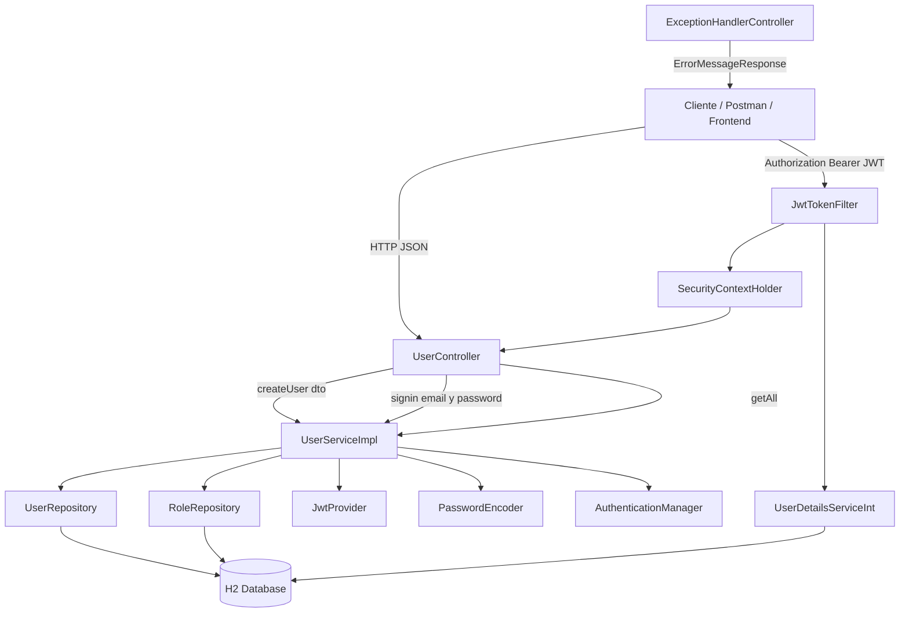
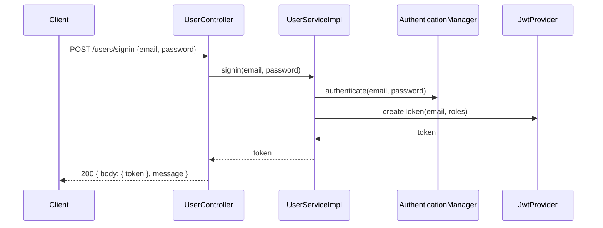

# UserApi
API REST para la **gestión de usuarios**, desarrollada en **Java con Spring Boot**, que implementa **autenticación JWT**, validaciones, manejo centralizado de errores y pruebas automatizadas.

Este proyecto fue construido siguiendo **buenas prácticas de arquitectura**, con foco en **legibilidad, mantenibilidad y testabilidad**, y es completamente ejecutable tanto desde IDE como por línea de comandos.

---

## Caracteristicas principales

- Registro de usuarios
- Inicio de sesión con JWT
- Consulta de usuarios
- Validación de datos de entrada
- Manejo centralizado de errores HTTP
- Seguridad con Spring Security + JWT
- Persistencia con JPA / Hibernate
- Base de datos en memoria (H2)
- Tests unitarios y de integración
- Documentación Swagger (OpenAPI)

---

## 🧱 Arquitectura

El proyecto está organizado siguiendo una **arquitectura por capas**:

- **Controller**: exposición de endpoints REST
- **Service**: lógica de negocio
- **Repository**: acceso a datos (JPA)
- **Domain / DTOs**: modelos de dominio y transferencia
- **Security**: autenticación y autorización JWT
- **Exception**: manejo centralizado de errores

---

### Arquitectura de alto nivel


---

### Diagramas de secuencia

#### Flujo de inicio de sesión


---

## Tecnologias utilizadas

UserApi usa varios proyectos open source para trabajar apropiadamente:

- [JJWT](https://github.com/jwtk/jjwt) - JJWT tiene como objetivo ser la biblioteca más fácil de usar y comprender para crear y verificar JSON Web Tokens (JWT) en JVM y Android.
- [Spring Boot](https://spring.io/projects/spring-boot) - Spring Boot facilita la creación de aplicaciones independientes basadas en Spring de grado de producción que puede "simplemente ejecutar".
- [Spring Validation](https://docs.spring.io/spring-framework/docs/4.1.x/spring-framework-reference/html/validation.html#validation-beanvalidation) - Spring Validation facilita la validacion de entradad de datos.
- [Spring Data JPA](https://spring.io/projects/spring-data-jpa) - Spring Data JPA, parte de la familia Spring Data más grande, facilita la implementación de repositorios basados ​​en JPA que en su defecto usa la implementacion de Hibernate.
- [Spring Boot Starter Web](https://spring.io/projects/spring-boot) - Es todo lo necesario para poder arrancar un proyecto web api en minutos.
- [H2 Database](https://www.h2database.com/html/main.html) - H2 es un sistema administrador de bases de datos relacionales programado en Java. Puede ser incorporado en aplicaciones Java o ejecutarse de modo cliente-servidor.
- [Java 11](https://www.oracle.com/asean/java/technologies/javase/jdk11-archive-downloads.html) - Es una versión importante de soporte a largo plazo (LTS) de Java que introdujo cambios significativos en la licencia de Oracle, haciéndola de pago para uso comercial, aunque sigue siendo gratuita a través de OpenJDK.
- [Spring Security](https://spring.io/projects/spring-security) - Es un potente framework de autenticación y control de acceso altamente personalizable. Es el estándar de facto para proteger las aplicaciones basadas en Spring.
- [JUnit 5](https://junit.org/) - Sirve de base para el lanzamiento de marcos de prueba en la JVM. También define la TestEngineAPI para desarrollar un marco de prueba que se ejecute en la plataforma.
- [Mockito](https://site.mockito.org/) - Framework de mocking para pruebas unitarias en Java que permite simular objetos y comportamientos.
- [MockMvc](https://docs.spring.io/spring-framework/reference/testing/mockmvc.html) - Framework de pruebas web para Spring MVC que permite simular las solicitudes HTTP y verificar los resultados.
- [Swagger (OpenAPI)](https://swagger.io/specification/) - Swagger es un conjunto de herramientas de código abierto que ayudan a diseñar, construir, documentar y consumir servicios web RESTful.

---

## 🔐 Seguridad

- Autenticación basada en **JWT**
- Filtro personalizado `JwtTokenFilter`
- Stateless session (`SessionCreationPolicy.STATELESS`)
- Manejo de errores HTTP (400, 401, 403, 409, 415, 500)

---

## Requerimientos

- [Git](https://git-scm.com/) - Git es un sistema de control de versiones distribuido de código abierto y gratuito diseñado para manejar todo, desde proyectos pequeños a muy grandes, con velocidad y eficiencia.
- [Java 11+](https://www.java.com/en/) - Java es un lenguaje de programación y una plataforma informática lanzada por primera vez por Sun Microsystems en 1995.
- [Visual Studio Code](https://code.visualstudio.com/) - Visual Studio Code es un editor de código fuente desarrollado por Microsoft para Windows, Linux y macOS. Version: 1.60.2 (Universal). Pero se puede utilizar cualquier otro de su preferencia (IntelliJ, eclipse, etc.).

---

## 📄 Documentación API (Swagger)

```
http://localhost:8080/swagger-ui.html
```

---

## Instalacion

Clone el repositorio.

```bash
git clone git@github.com:luchonetvv/user-api.git
git status
```
Instalar Visual Studio Code y luego abrir el proyecto...
Con solo ejecutar el proyecto desde la clase LuchonetvvApplication.java, es decir,
click en Run y estara listo para crear usuarios.

O si tu quieres construir e instalar desde la terminal, aqui estan los pasos:

On Mac or Linux

---

## 🧪 Testing

Ejecutar todos los tests:

```bash
./gradlew clean test
```

---

## ▶️ Ejecución del proyecto

```bash
./gradlew bootRun
```

---

## Demo

Coleccion de postman para probar API [Collection Postman](https://github.com/luchonetvv/user-api/blob/main/UserApi.postman_collection.json)


---

## 📜 Licencia

Apache License, Version 2.0

---

## ✍️ Autor

**Luis Alberto Guido Calderón**  
https://github.com/luchonetvv
